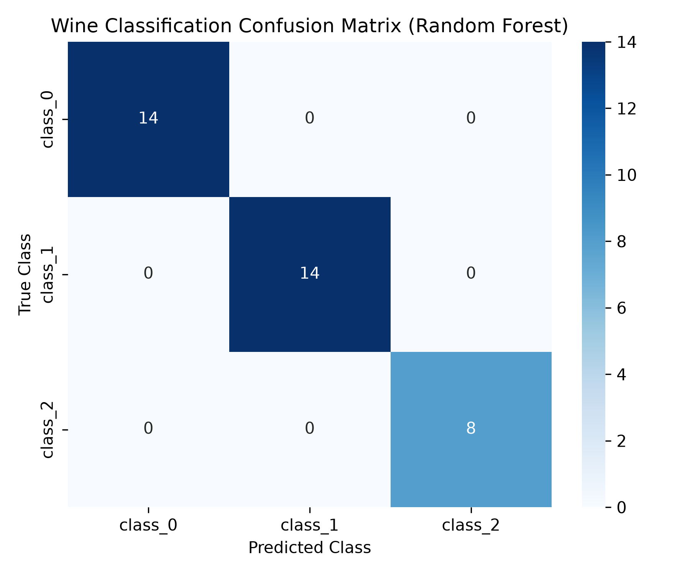
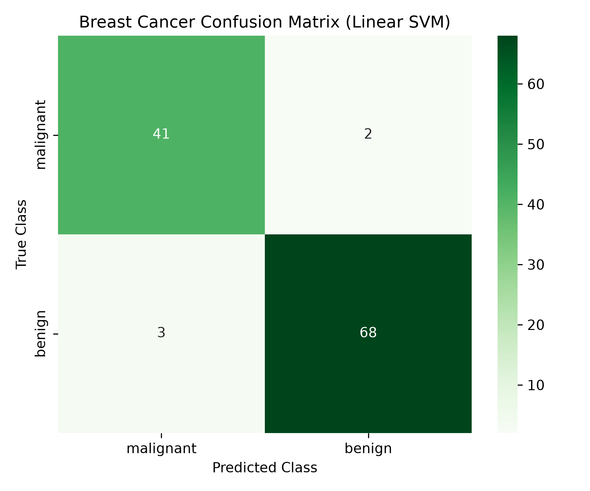
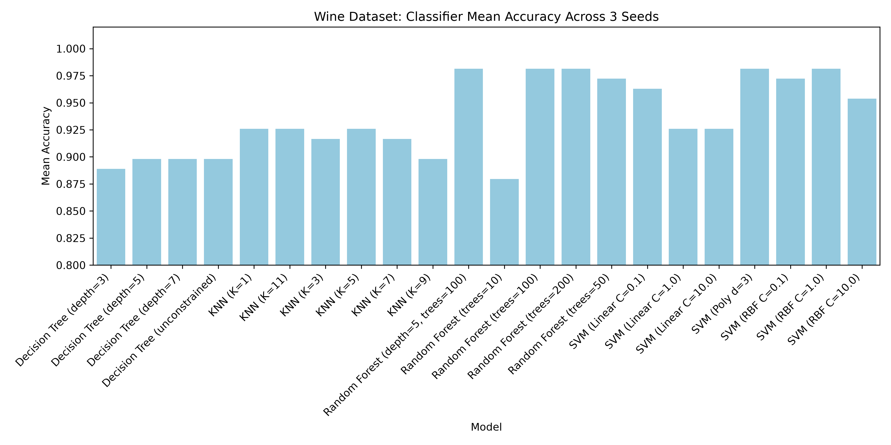

# Machine Learning Classification & Clustering Benchmark Suite

This repository contains a comprehensive machine learning pipeline evaluating supervised classifiers and unsupervised clustering algorithms across the **Wine Quality** and **Breast Cancer Wisconsin** benchmark datasets.

My video link: https://youtu.be/XJwC56zzAbM

## Repository Structure

- `main.py`: Complete execution pipeline generating 144 model fits (132 classifier runs across 3 random seeds and 22 configurations, plus 12 K-Means clustering runs).
- `*.csv`: Raw run logs and aggregated summary statistics (mean & standard deviation).
- `*.png`: Confusion matrices and performance comparison charts.
- `*.ipynb`: Interactive Jupyter notebooks containing the step-by-step execution.
- `AI_DISCLOSURE.md`: Academic integrity and AI usage disclosure statement.

---

## Experimental Setup & Summary

- **Supervised Classifiers (132 runs):** 
  - Evaluated **KNN**, **Linear/RBF/Poly SVM**, **Decision Tree**, and **Random Forest** across 22 distinct hyperparameter configurations.
  - Executed across **3 random seeds** (`42`, `10`, `100`) to ensure statistical stability and measure variance.
  - Feature scaling (`StandardScaler`) was systematically applied to distance-sensitive models (KNN, SVM).

- **Unsupervised Clustering (12 runs):**
  - Evaluated **K-Means** clustering across $K$ and $K+1$ cluster configurations, measured using Adjusted Rand Index (ARI), Silhouette Score, and Inertia.

---

## Key Results & Visualizations

### 1. Wine Dataset: Random Forest Confusion Matrix

*Random Forest achieved 100% accuracy on the test subset, perfectly separating all three wine cultivar classes.*

### 2. Breast Cancer Dataset: Linear SVM Confusion Matrix

*Linear SVM demonstrated robust performance (96.49% accuracy) on biomedical feature boundaries.*

### 3. Model Accuracy Comparison (Wine Dataset)

*Comparison of mean test accuracy across all 22 classifier variations over 3 random seeds.*

---

## Setup & Execution

1. Install dependencies:
```bash
pip install -r requirements.txt
python main.py
```